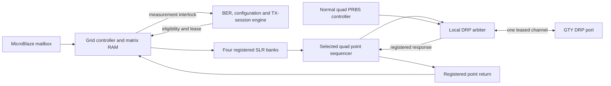

# Eye-scan v1 image and operator interface

For practical commands and result handling, see the
[eye-scan how-to](eye-scan-howto.md).

Development target: **`0x00020503`**, `gt_test_eye_scan_v1_top`, part
`xcvu13p-flga2577-2-e`, Vivado 2023.2.2. **Unreleased for hardware.** The
initial route failed setup; the corrected normal implementation passes
setup/hold at +0.001/+0.009 ns with zero failing endpoints. Independent routed
audit and compressed BIT/BIN qualification pass. No deployment, programming,
reset, MCU access or hardware eye scan has occurred during development.

The working v2 and statically qualified v3 sources, artifact pins and
launchers remain preserved. The accepted scope and point-engine evidence are
in [eye-scan-plan.md](eye-scan-plan.md).

## Architecture and operating boundaries

One global controller selects a receiver and executes a rectangular grid of
at most **4096 points**. Each of the 28 managed quads has an independent point
sequencer and a DRP arbiter; only the selected quad may start. DRPEN ownership
is local, so a central fabric mux never directly drives all 112 DRP ports.
Payload and phase travel through four registered SLR banks; tagged results
return through registered pipelines. DRP requests are queued before the GT
launch pulse; normal PRBS requests retain passthrough and replies add one
registered cycle. The controller acknowledges each local
result only after appending it to the matrix BRAM. Each record is immutable;
the completed matrix prevents another scan until explicit acknowledgement.



Bank ready/fault/idle/acquire/capture status, fault reasons and diagnostic
payload share two return stages before global reduction, preserving their
alignment and lowest-bank fault priority. Tagged TX-session/configuration
handshakes keep their existing latency and semantics. The result-copy helper
registers selected active/fault bits locally within the existing six-phase
copy schedule. Read-page selection is registered before word/byte selection.

Point sampling, dwell deadlines, counting, cancellation, restoration and
matrix storage run in HDL. MicroBlaze validates and transports requests and
pages; it does not poll GT DRP or sample counters. Normal BER still uses its
existing descriptor/interrupt protocol and its existing result banks.

Both runtime quad masks boot at zero and require explicit configuration.
Scans require an enabled receive quad, the inspected full-rate GT profile,
native synchronized CDR/reset-done indications and quad health. The image
retains the generated constant LPM equalizer mode; the standalone point
engine and offline decoder also support two-pass DFE, but this image offers
no equalizer-change command. The sampler must already be powered at image
initialization. No per-scan PMA reset or automatic recovery is introduced.

The existing BER engine independently blocks BER starts, configuration, and
new TX sessions while the eye controller is active or fatally locked. A TX
stop remains available. The global eye controller requires sufficient local
TX-session time whenever local TX quads are enabled. The operator explicitly
names the external transmitter site and quad, checks both endpoints' masks
and clocks, and starts bounded sessions only on sites with TX enables.
Sessions drive all configured TX quads on that site; any outward FireFly TX
requires acknowledgement. The tool does not infer physical wiring or change
configuration as part of a scan.

The overall budget reserves its final 10 ms for cancellation/restoration;
sampling stops when that reserve begins. The accepted budget must fit the
remaining local TX lease with a further 10-ms margin. Host-started leases
include 60 seconds beyond the scan budget for transport/cleanup. No lease is
renewed. A missing point result, failed stop, failed register restoration or
failed response drain leaves a fatal lock and inhibits normal operations.
No reset/program/retry operation is present.

Matrix retrieval occurs after session cleanup. Success and failure save raw
JSON/CSV; the process log/report includes source/artifact hashes, clocks,
configuration and pre/during/post telemetry when observable. A failed
retrieval preserves already retrieved points and the authoritative log.
Results remain in FPGA memory until `ack --job` explicitly consumes them.
This permits investigation and an ordinary BER check before clearing data.

Native lock indications retain the limitations documented for prior images;
they do not prove optical interruption detection or physical connectivity.
The hardware gate still requires a one-receiver IBERT comparison and an
ordinary clean BER test after the scan.

## Register and mailbox ABI

Existing generic address `0x2B`, scratch/clock/status words, normal BER lane
records and selectors `0xFE`/`0xF7` are preserved. New diagnostic selectors:

| Selector | D0–EC words |
|---|---|
| `F6` progress | Schema `45595001`, job ID, status, stored count, accepted H descriptor, accepted V descriptor, remaining budget ms, selected page |
| `F5` point page | Schema `45594401`, job ID, metadata, H/V position, errors0/samples0, errors1/samples1, elapsed management cycles, profile `50020101` |

Point metadata bits: 0 valid, 1 phase, 2 fatal, 3 cleanup verified,
5:4 captured UT pairs, 13:6 point status, 14 LPM, 19:15 prescale,
26:20 global lane, 28:27 vertical range, 29 saturated elapsed time.
Position bits 10:0 are signed horizontal offset and 19:11 signed vertical
offset. Each counter word packs errors in bits 15:0 and samples in 31:16.
The profile bytes identify width 80, internal-width encoding 2, unified phase
1 and RX output divider 1. No voltage calibration is asserted.

Progress status bits: 0 busy, 1 completed matrix available, 2 fatal,
3 rejected command, 7:4 controller state, 31:16 job reason. Job-reason low
bits 0–7 mean invalid/oversized grid, explicit cancellation, lost eligibility,
budget reserve reached, failed point, local fatal, matrix overflow, and
protocol/deadline failure. Its high byte retains a failing point's status.
Point-status bits are described in `eye-scan-plan.md`.

States 0–8 are IDLE, VALIDATE, PRELOAD, WAIT_POINT, STORE, ACK, DRAIN, NEXT
and FINISH. These FSM registers retain `fsm_encoding="none"`.

Commands use the existing sequence-last mailbox. Every
new command consumes a request sequence and preserves the ordinary BER run
ID. All generic multibyte values remain little-endian.

| Command | A8 | AC | B0 | B4 | B8 | BC |
|---|---|---|---|---|---|---|
| 5 start | total budget ms | point deadline in 200-MHz cycles | H/lane descriptor | V descriptor | prescale | 0 |
| 6 cancel | 0 | 0 | expected job ID | 0 | 0 | 0 |
| 7 select page | 0 | 0 | page index | expected job ID | 0 | 0 |
| 8 acknowledge matrix | 0 | 0 | expected job ID | 0 | 0 | 0 |
| 9 select progress | 0 | 0 | 0 | 0 | 0 | 0 |

H/lane descriptor: bits 6:0 global lane; 13:7 signed H first; 20:14 signed
H last; 26:21 positive step; upper bits zero. V descriptor: bits 7:0 signed
V first; 15:8 signed V last; 23:16 positive step; upper bits zero. H is
restricted to −32…32 with step 1…32; V is −127…127 with step 1…127.
Axes are inclusive while values remain within the requested bounds; a
non-divisible step stops at the last reachable coordinate. H advances first.
Hardware validates the complete grid size before issuing any point request.
Response code zero means command acceptance; progress carries scan outcome.

New AXI offsets are `140/144/148` for staged H/V/prescale, `14C/150` for
budget/deadline, `154` for start/cancel/ack doorbell values 1/2/4,
`158` status, `15C` page selection, `160` count, `164` job ID and
`168` planned point count. Full-word writes are required. Partial/invalid or
competing writes are rejected without changing an accepted scan descriptor.

## Operator tools after release

Package reviewed runtime files locally:

```sh
python3 scripts/package_eye_scan_v1_runtime.py
```

The exclusive generated directory contains seven Python files and a source
manifest. It must be accompanied by clean `cm_interface` tag `v1.0.3`, commit
`64260cf23b01c9da987feda1fbf51567240c2c71`. Board commands verify that exact
tag/commit, source hashes, firmware/hardware identity and sequence state.
They share the existing software lock and MCU transaction implementation.
Python 3.6 syntax is preserved. `RELEASED=False` blocks every mutating command
before registry construction; no artifact has been released by packaging.

Future same-endpoint optical-loop example, after a reviewed hardware gate:

```sh
python3 board_eye_scan.py configure --site F1 --tx q121 --rx q121 --acknowledge-firefly-tx
python3 board_eye_scan.py configure --site F2 --tx none --rx none
python3 board_eye_scan.py scan --receiver F1 --quad q121 --lane 0 \
  --transmitter F1 --tx-quad q121 --acknowledge-firefly-tx
```

Default grid is H `-32:32:2`, V `-120:120:8` (1023 points), prescale 5,
120-second total budget and 1000-ms point deadline. Use `--horizontal=...`
and `--vertical=...` for negative-leading specifications. The host rejects
prescale/deadline/budget combinations that cannot cover a zero-error
accumulation. High prescale values remain representable in raw records but
cannot all finish within the 32-bit management-cycle deadline.

The explicit `--transmitter`/`--tx-quad` must match bench wiring; this is not
an automatic F1-to-F2 or lane-map assumption. Other enabled TX quads emit
PRBS31 for the same bounded session. RX-only operation does not require a
local transmitter; the declared peer must be enabled and running.

Inspect retained progress or explicitly cancel/consume a matching job:

```sh
python3 board_eye_scan.py status --site F1
python3 board_eye_scan.py cancel --site F1 --job 1
python3 board_eye_scan.py ack --site F1 --job 1
```

Cancellation does not erase the matrix. An interrupted scan attempts bounded
matching-job cancellation and unconditional owned-session cleanup, preserves
partial evidence, and returns failure. It never retries a measurement or
automatically acknowledges the retained result.

Plot JSON offline on a host with NumPy/Matplotlib; no library checkout, MCU
connection or release flag is required for plotting:

```sh
python3 scripts/board_eye_scan.py plot logs/eye-scan-v1-EXAMPLE.json --output-prefix eye-example
```

This writes exclusive PNG/PDF files containing a logarithmic sampler-mismatch
heatmap and central horizontal/vertical slices. Horizontal units are UI for
the qualified full-rate profile; vertical units remain codes. Zero-error
points display 95% binomial upper bounds, with the independence assumption
stated. DFE data use separate denominators and an average of conditional UT
ratios; simultaneous zero-count bounds allocate confidence to both passes.
Invalid/missing points are blank. Ratios are recomputed from raw words; cached
derived fields are never trusted. This is an eye-sampler comparison against
recovered data, not an ordinary link BER qualification.

## Validation and current build state

Passed focused tests:

- Updated point/DRP simulations: 49 point cases and 17 arbiter scenarios,
  including held old RDY before queued launch and queued-launch timeout.
- Global grid/storage/budget/cancel controller: 13 cases.
- Real point/DRP integration in the q121 wrapper, including changed lanes,
  phases and cancellation/restoration.
- Four-bank dispatch across all 28 quads and preserved session/BER barriers.
  A 160-cycle comparison with preserved v3 also verifies the matched two-clock
  status/diagnostic delay and exact session/configuration handshake latency.
- Existing engine regression plus new eye/config/BER/session interlocks,
  including independently delayed ACK return data and phase.
- Full integrated RTL elaboration, exact synthesis/preflight, and matching
  `0x00020503` firmware compilation.
- 21 offline Python tests including failure cancellation/session cleanup,
  active-peer protection, final platform-fault detection, partial retrieval
  preservation, schema/identity/budget checks, release
  guards, Python 3.6 grammar, exclusive artifacts and PNG/PDF plotting with
  the full requested extent preserved for partial matrices.
- Unchanged v3 operator tests 27/27 and unchanged v2 helper tests 15/15.
- All seven unchanged historical simulation runners pass; log
  `build/logs/run_all_links_v3_historical_regression-20261113T182520Z.log`.

Initial full synthesis passed; its first preflight stopped because the new
initialization hook used design `NAME` (Vivado reports `design_1`) instead of
`TOP`. The guard now checks the actual top without relaxing identity. Exact
source-checksum-pinned synthesis was resumed, not repeated. Preflight passes
112/28/12 GT inventory, 6/8/8/6 participation, 28 local points and DRP owners,
one global controller, matrix BRAM, all 112 initialized eye circuits, 256
two-cycle speculative descriptor-payload endpoints, and 2056 real return
registers. Phase/cancel/ACK/permission and return paths retain ordinary
one-cycle timing; sampled payload settles for 16 clocks before launch.

The initial normal route failed setup at WNS/TNS **-0.264/-58.683 ns** over
646 `clk_200` endpoints. Hold passed +0.010 ns, all 277907 routable nets are
complete, and routing errors/Error DRCs are zero. No audit or bitstream
followed. The exact 1525 build inputs, project, reports, logs and timing
triage are preserved under
`build/diagnostic_archive/eye-scan-v1-initial-route-timing-failure/`.
Routed DCP SHA-256 is
`68da98b17db1e42ae5e1d09ee6e1c2c4a8ab496a48ed8f26654c480e067ac878`.

Path-guided corrections address GT-reply-to-control/reset fanout, remote
active-mask-to-copy resets, BRAM-to-read-bus mux depth, and distant diagnostic
returns. They add registered boundaries without new timing exceptions.
Updated focused simulations pass; logs have stamps `190343Z`, `190528Z`,
`190529Z`, `190418Z` and `190633Z` under `build/logs/`.
A fresh project from preserved v3 completed normal route through
`scripts/build_eye_scan_v1_routed.tcl` in attached session `89378`; log
`build/logs/build_eye_scan_v1_routed-20261113T190835Z.log`.
Fresh synthesis and structural preflight pass. A separate primitive-level
check confirms zero direct GT-output fanin at all 51744 D/R/CE inputs of
17248 point registers; log
`build/logs/check_eye_registered_synth-20261113T192316Z.log`.
This replaces an ineffective query of optimized-away hierarchy port aliases;
the routed audit uses actual primitive inputs. Both normal and delayed-ACK
variants of the added all112-to-sparse engine reuse test pass (`191736Z`).
Normal routed signoff passes +0.001/+0.009 ns, all 281988 routable nets
are complete and routing/Error DRC failures are zero. Independent audit passes (session `79936`); log
`build/logs/audit_eye_scan_v1_routed-20261113T201846Z.log`. No historical
implementation or hardware gate has been repeated.

Independent audit and BIT/BIN emission are strictly gated by routed timing,
routing, DRC, topology, CDC/descriptor/session structure and the allowed two
eye-parameter differences against the exact v3 baseline. Candidate input
manifests and implementation evidence stay under ignored `build/`.

### Reset ownership audit evidence

The first independent audit stopped on its strict bank-name reset-fanout
assertion. Its reports and exact verifier are preserved under
`build/eye_scan_v1_audit_attempt1_reset_ownership_failure/`.
Read-only inspection found two optimizer reassignments on the unchanged
routed DCP: SLR1's first-stage release drives bank0 diagnostic bit32's R pin;
SLR3's release drives the D pin of bank2's retained right-quad reset bit3.

All four first-stage releases are FDREs with INIT=0, CE=1, R=0, identical
D/clock drivers and no implemented pin inversion. Thus each produces the
same `resetn` delayed by one rising management-clock edge. Feeding a local
second-stage D from any of those equivalent outputs preserves its two-edge
release latency. The focused proof additionally checks that this retained
second stage stays in SLR2 and its Q drives only its original quad. The
reassigned diagnostic register feeds only bank0's status-publication data.
Both aliases retain ordinary 5-ns setup timing and passing hold: setup/hold
slacks are +2.166/+1.138 ns and +1.992/+0.710 ns respectively.

`check_eye_scan_reset_ownership.tcl` now proves these conditions in the audit;
all other cross-bank reset loads still fail. Existing 6/8/8/6 residency,
KEEP, controller, barrier and timing checks remain required. No RTL,
constraint, clock or routed checkpoint was changed for this audit amendment.
Focused proof: `build/eye_scan_reset_proof_1794600935088075/`; log
`build/logs/check_eye_reset_ownership-20261113T201531Z.log`.

The offline plot example under
`build/eye_scan_offline_demo_1794594404732890/` is explicitly marked
**SIMULATED DATA** and is not hardware evidence.


## Frozen static candidate

The independent audit passes exact 112/28/12 topology, 28 dedicated common
reference routes, 224 QPLL0 sinks, 313936 GT property comparisons, registered
DRP boundaries, sessions/configuration, reset proof and routed setup/hold.
All 532 skew groups pass. The setup margin is **0.001 ns**; this is static
qualification, with hardware behavior still untested.

Compressed BIT/BIN were emitted only after the audit. Header verification
proves the target top, exact part, `COMPRESS=TRUE`, and byte-for-byte identity
of the BIN with the BIT payload (69306960 bytes).

| Artifact | SHA-256 |
| --- | --- |
| BIT | `e170ead04e42c662e4a711c156a048e22da3c7c280e6820a6e644daec5b2850f` |
| BIN | `2cd866a689bdf3c2b89e1c26cf363c23180f1ecee3ea984b821ee3293fe7eb0a` |
| Routed DCP | `af25ba8aa3f5d04437af04f854631b2605b005355bd5f5399f4e7f5157e40873` |
| Synth DCP | `7f3ca87b62ec7f49d9591b837f9a75a09f805afa25c3206972e389dbb2b834c5` |
| ELF | `c9b85dbce9299d50974b660e40778806a4d86d4354a181035a9848e5d42445e7` |

Evidence is frozen under
`build/diagnostic_archive/eye-scan-v1-0x00020503-static-candidate/`, including
1526 verbatim build inputs with independent copy hashes, five artifact
hashes, original build/audit reports, verifiers, runtime bundle and source
overlay. Generated products remain ignored and uncommitted.

After artifact freezing, the ineffective hierarchy-port preflight query was
replaced with the same real primitive D/R/CE proof already used successfully
by the independent audit. Build messages were corrected to identify eye v1; future builds also hash
the newly sourced primitive-check helper.
These are validation/message changes only; original used scripts remain in
the input archive. No RTL, constraint, checkpoint or bitstream was changed.
The original working-directory implementation manifest therefore intentionally
no longer matches the cleaned validation scripts. Frozen input copies and
artifact manifests retain the exact build provenance. The independent audit
supports `::eye_audit_input_archive` for a future read-only audit of that
frozen candidate.

### Atomic command publication across large matrices

The mailbox request word is byte writable and firmware acts on any changed
32-bit sequence. An ordinary binary increment across a byte carry could
publish an intermediate request while I2C writes the word. Eye tooling uses
the next reflected-Gray-code value, computed from the current value, then
writes **only the one changed byte** after staging/readback of all operands.
Exactly one bit changes and no intermediate request exists. Firmware needs
only unequal request/handled values; numerical ordering is not part of this
protocol. The sequence does not wrap its full 32-bit Gray cycle; exhaustion
fails closed. Tests exercise 4200 commands from each of five initial values,
including all three byte-carry boundaries, with no duplicate value or
multiple-bit transition. No FPGA/firmware rebuild is needed for this host fix.
Do not substitute a historical launcher's binary sequence writer on this
image. The image contract has audited pins but keeps `RELEASED=False`.

Final read-only corrected preflight passes on the exact frozen synthesis
DCP, with no checkpoint write; log `build/logs/check_eye_final_synth-20261113T204913Z.log`.
The first standalone invocation stopped at its project-file guard; enabling
the existing checkpoint-only mode resolved that invocation error.
