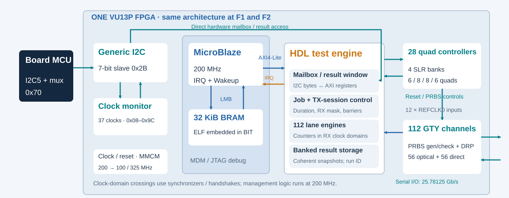

# FPGA firmware block diagram

[Download SVG](fpga-firmware-block-diagram.svg) ·
[Download PNG](fpga-firmware-block-diagram.png). The same diagram is an
editable slide in the [project PowerPoint](presentations/vu13p_25g_project_talk.pptx).
It describes one FPGA; F1 and F2 use the same audited image and architecture.
The boxes show functional ownership, not physical placement or one shared
clock domain.

## Control and result access

The external board MCU selects one FPGA through mux `0x70` and holds the
I2C5 semaphore for the transaction. Inside the FPGA, the generic slave at
7-bit address `0x2B` accesses two hardware register regions:

- Below byte address `0xA0`: scratch words, 37 clock readings and clock status.
- From `0xA0`: the request mailbox, versions/state, result selector, published
  lane record and completion fields.

I2C byte reads and writes go directly to hardware. MicroBlaze does not serve
each I2C byte. Instead, the processor reads the mailbox through AXI4-Lite,
validates a new job, writes the executable descriptor and issues one start
doorbell. See [the register ABI](gt-test-engine.md#i2c-mailbox).

## Embedded MicroBlaze subsystem

MicroBlaze runs at 200 MHz with 32 KiB of local instruction/data block RAM,
no caches and no operating system. Its AXI4-Lite master reaches the test
engine at `0x44A00000`. It sleeps during acquisition/measurement, then wakes
on the engine's completion interrupt; the completion level drives both IRQ
and Wakeup. MDM provides JTAG debug access.

The matching ELF is scoped to the MicroBlaze instance during the Vivado
build and becomes BRAM initialization data in the compressed BIT. Loading
that audited BIT through either Hardware Manager or XSDB loads the embedded
program too. A new test can reuse a healthy running image; reprogramming is
not required before each run.

## Parallel measurement and clock domains

The test engine controls job timing and the shared TX session. Its 112 lane
engines accumulate receive exposure and publish coherent results. Four
registered result-copy banks and explicit CDC handshakes bring RX-domain
snapshots to the management domain; published storage stays immutable until
the next complete publication.

Four SLR banks distribute 28 quad controllers in a 6/8/8/6 pattern. They
manage 112 GTY channels: 56 FireFly lanes in q121–q134 and 56 direct lanes in
q221–q234. Native GT resources generate/check PRBS and provide DRP error
counters. Twelve physical managed-GTY REFCLK0 inputs support this topology;
the line rate is 25.78125 Gb/s. The 10-Gb/s AXI C2C lanes are excluded.

The shared TX session enables all 112 transmitters per FPGA. The receive
mask chooses what is measured; it does not suppress the other transmitters.
See [HOWTO.md](../HOWTO.md) for supported selectors and the operator workflow.

## Implementation sources

- [Top-level ownership](../src/gt_test_all_links_v1_top.sv): shared top used by
  the v2 project with its `0x00020501` version override.
- [Integration core](../src/gt_test_direct_quad_v6_core.sv): I2C frontend,
  monitor, MicroBlaze subsystem, AXI engine, clocks and quad-bank connections.
- [Engine core](../src/gt_test_engine_core.sv): mailbox, sequencer, lane
  measurement and publication logic.
- [Vivado project](../scripts/create_all_links_v2_project.tcl): v2 target and
  ELF association.
- [Diagram generator](presentations/make_project_talk.py): produces both
  editable PowerPoint objects and the standalone SVG from the same drawing.
